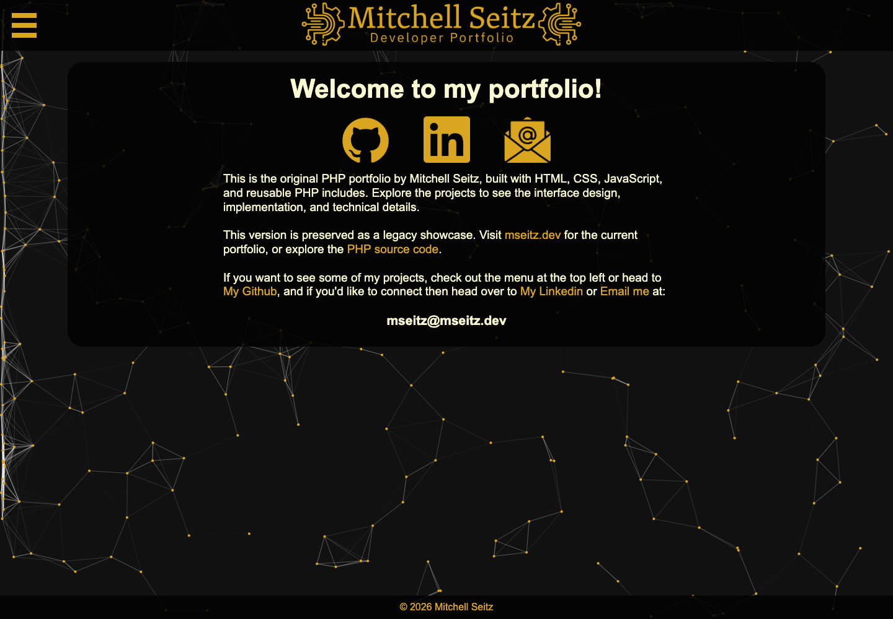

# Developer portfolio — original PHP implementation

The legacy portfolio designed and implemented by **Mitchell Seitz** in 2024
using **PHP, HTML, CSS, and JavaScript**. This repository preserves the original
interface and implementation as a public code showcase.

**Active portfolio:** [mseitz.dev](https://mseitz.dev) ·
**Active development:** [Eleventy repository](https://github.com/mseitzdev/mseitz.dev)



## Design and implementation

- Black and gold visual design, custom logo and interface graphics.
- Sliding navigation with nested dropdowns and JavaScript interactions.
- Reusable PHP includes for the header, navigation, footer, and social links.
- Project pages combining technical write-ups, screenshots, and demonstrations.
- A customized Particles.js background with translucent content panels.
- Layout and styling developed through testing across browsers and devices.

Start with [`res/main.css`](res/main.css), [`res/menu.php`](res/menu.php),
[`res/header.php`](res/header.php), and [`webDevelopment/mseitzDotDev.php`](webDevelopment/mseitzDotDev.php)
to explore the original UI work. Third-party code and tutorial influences are
credited below.

## Run locally

With PHP 8.4 installed, run this from the repository root:

```sh
php -S 127.0.0.1:8081 -t .
```

Open <http://127.0.0.1:8081>. No database, Composer dependencies, or frontend
build step is needed. Video demonstrations require an internet connection.
The built-in development server uses HTTP; the shared header requires HTTPS
when hosted with a production PHP server.

## Repository status

This is a sanitized maintenance snapshot of the original PHP project. Personal
biographical pages and their assets have been removed, project links and preview
images refreshed, and local development setup updated. Published Git history
starts with this snapshot rather than the original development timeline.

The original PHP UI predates the AI-assisted Eleventy migration. The current
privacy and documentation cleanup was also AI-assisted. Original source
attribution and third-party credits are retained.

Future portfolio development takes place in the Eleventy repository linked above.

## Credits

- [Vincent Garreau — Particles.js](https://github.com/VincentGarreau/particles.js):
  background animation, customized in `res/particles/app.js`.
- W3Schools [side navigation](https://www.w3schools.com/howto/howto_js_sidenav.asp)
  and [dropdown side navigation](https://www.w3schools.com/howto/howto_js_dropdown_sidenav.asp):
  references for the menu implementation.
- [Remi Laudanski](https://codepen.io/remilaudanski),
  [study-navigation example](https://codepen.io/remilaudanski/pen/gbBGyN):
  inspiration for the mathematics study-resource menu.

Copyright Mitchell Seitz, 2024–present. Third-party components retain their
respective notices.
